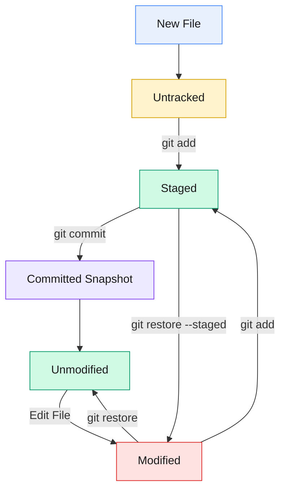

# Lifecycle and Working Flow of Git

The Git lifecycle or Working Flow refers to how files move through various states and operational areas used to manage version control. It is best understood through two core concepts: **File States** and **Operational Areas**.

## The 4 Operational Areas

Git uses four important operational areas to manage files, prepare changes, store project history, and collaborate with others.

| **Area** | **Purpose** | **Key Command / Concept** |
|---|---|---|
| **Working Directory** | Your local project directory where you create, delete, and modify files. | `git init` |
| **Staging Area (Index)** | The intermediate area where you select and prepare changes for the next snapshot. | `git add <file>` |
| **Local Repository** | The local Git database inside the `.git` directory that stores commits and project history. | `git commit -m "message"` |
| **Remote Repository** | A hosted repository, such as GitHub or GitLab, used for sharing and team collaboration. | `git push` |

### Working Flow

The typical workflow for saving and sharing changes follows this sequence:

1. **Working Directory:** Create or modify files.
2. **Staging Area:** Select changes using `git add`.
3. **Local Repository:** Record staged changes using `git commit`.
4. **Remote Repository:** Share local commits using `git push`.

> **Note:** These are operational areas, not file states. The remote repository is separate from your local environment, and `git push` transfers commits rather than individual unstaged files.

---

## The 4 Common File States

Within your local environment, Git tracks files according to their current status. The four commonly described file states are **Untracked, Unmodified, Modified, and Staged**.

### Git File Lifecycle Diagram



### Explanation of File States

- **Untracked:** A new file exists in the working directory, but Git is not tracking it yet.
- **Unmodified:** A tracked file's content in the working directory matches the version in the latest commit.
- **Modified:** A tracked file has been changed in the working directory, but its latest changes have not been staged.
- **Staged:** Changes have been added to the staging area using `git add` and are prepared for the next commit.

### What Happens After a Commit?

When you execute `git commit`, Git records the staged changes as a new snapshot in the local repository. If a tracked file's working copy matches that snapshot, its state becomes **Unmodified**.

Therefore, **Committed** describes the result of a commit operation rather than a separate ongoing file state.

---

## Essential Git Commands

| **Command** | **Purpose** |
|---|---|
| `git status` | Shows the current state of files in the working directory and staging area. |
| `git add <file>` | Stages a new file or changes to a tracked file. |
| `git add .` | Stages changes under the current directory, subject to Git's ignore rules. |
| `git commit -m "message"` | Records staged changes as a commit in the local repository. |
| `git restore <file>` | Discards unstaged changes to a tracked file by restoring it from the index. |
| `git restore --staged <file>` | Removes changes from the staging area while keeping the working-directory changes. |
| `git push` | Sends local commits to a configured remote repository. |
| `git fetch` | Downloads updates from a remote repository without integrating them into the current branch. |
| `git pull` | Fetches remote updates and integrates them into the current branch. |

> **Warning:** `git restore <file>` can permanently discard unstaged changes. Check `git status` before running it.

---

## Quick Mental Model

Remember the difference between Git's operational areas and file states:

- **Working Directory:** Where you create and modify files.
- **Staging Area:** Where you select changes for the next commit.
- **Local Repository:** Where Git stores committed snapshots and project history.
- **Remote Repository:** Where commits are shared for collaboration.

### The Core Workflow

```text
Working Directory
       |
       | git add
       v
Staging Area
       |
       | git commit
       v
Local Repository
       |
       | git push
       v
Remote Repository
```

**Key takeaway:** `git add` stages changes, `git commit` records a snapshot, and `git push` shares commits with a remote repository.


